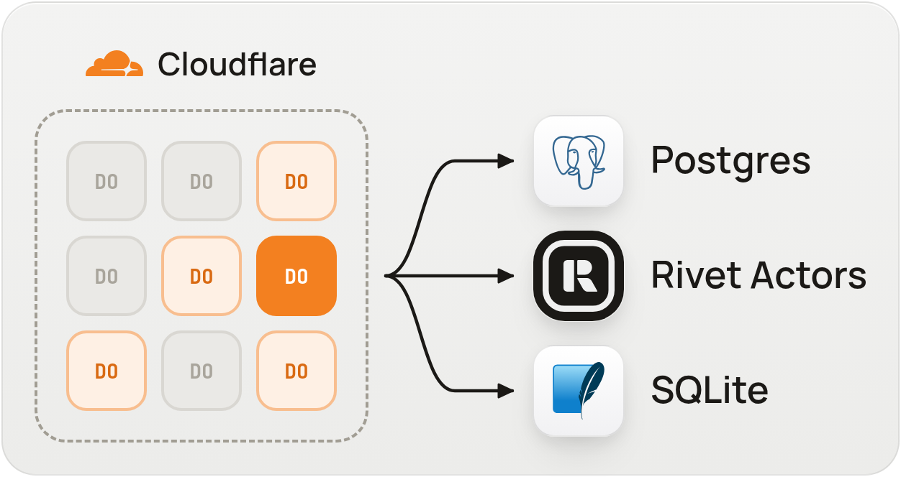
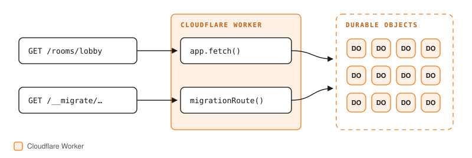
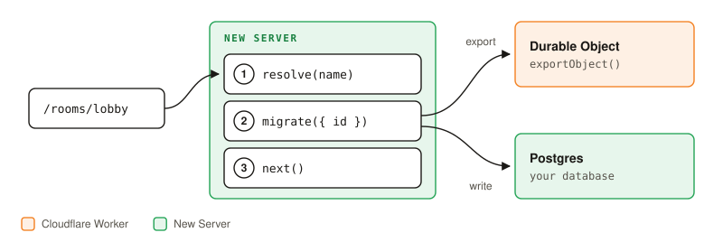
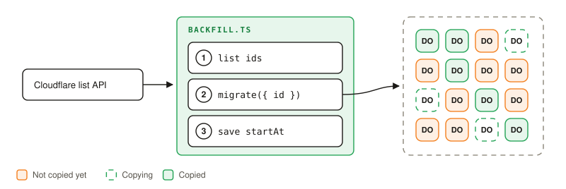
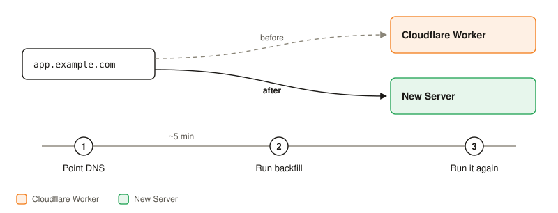
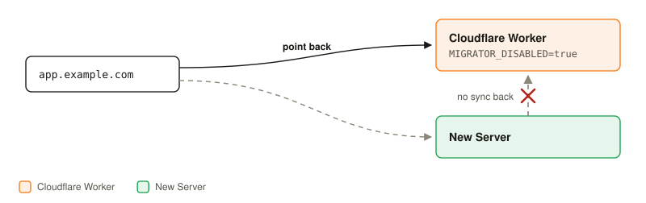

<p align="center">
  
</p>

<h1 align="center">Durable Object Migrator</h1>

<p align="center">Move Cloudflare Durable Objects to your own server with no downtime and no lost writes.</p>

<p align="center">
  <a href="docs/guide.md">Guide</a> ·
  <a href="examples/">Examples</a> ·
  <a href="https://rivet.dev/discord">Discord</a>
</p>

## Use a coding agent

Paste this into your coding agent (Claude Code, Codex, Cursor, …) from your project:

```text
Migrate this project's Cloudflare Durable Objects off Cloudflare with
@rivet-dev/durable-object-migrator.

1. First, ask me where the data should go: Postgres, Rivet Actors, SQLite
   files, or something else.
2. Then read https://github.com/rivet-dev/durable-object-migrator/blob/main/README.md
   and follow its quickstart for that destination. Use the matching example in
   examples/ and the limits in docs/guide.md.
```

## What it does

Cloudflare has no way to export a Durable Object's data. This package adds an export route to your Worker, then copies each Durable Object to your new server in three steps:

1. **Wrap.** Add 2 lines to your Worker.
2. **Lazy migration.** Point your domain at the new server. Each Durable Object is copied the first time a request needs it.
3. **Backfill.** A background job copies every Durable Object that got no requests. If it stops, it picks up where it left off.

Works with SQLite-backed Durable Objects (`new_sqlite_classes` in your wrangler config). Older KV-backed ones are not supported.

## Quickstart

You edit two codebases:

- 🟠 **Cloudflare Worker:** where your Durable Objects run today.
- 🟢 **New Server:** the server you are moving to.

Install the package in both:

```sh
npm install @rivet-dev/durable-object-migrator
```

| Import | Use in | Does |
|---|---|---|
| `@rivet-dev/durable-object-migrator/worker` | 🟠 Cloudflare Worker | Adds the export route, and blocks a Durable Object once it is copied |
| `@rivet-dev/durable-object-migrator/client` | 🟢 New Server | Copies each Durable Object's data, and finds the ones nobody used |

The paths below are examples. Use your own layout.

### Step 1: Add the migrator to your Durable Object



🟠 **Cloudflare Worker:** edit your Worker's entry file.

```ts
// worker/src/index.ts
import { migratable, migrationRoute } from "@rivet-dev/durable-object-migrator/worker";

export const Room = migratable(RoomImpl); // wraps your Durable Object class

export default {
  fetch(req, env, ctx) {
    // Handles /__migrate/* requests. Returns null for everything else.
    const migratorResponse = migrationRoute(req, env, { token: env.WORKER_MIGRATOR_TOKEN });
    if (migratorResponse) return migratorResponse;

    return app.fetch(req, env, ctx);
  },
};
```

> [!TIP]
> **Using [Alchemy](https://alchemy.run)?** Effect-native Durable Objects use `@rivet-dev/durable-object-migrator/alchemy` instead. See the [Alchemy guide](docs/alchemy.md).

Set `WORKER_MIGRATOR_TOKEN` with `wrangler secret put` and deploy. Nothing changes for your users yet.

### Step 2: Set up lazy migration

Lazy migration copies each Durable Object the first time someone uses it. When a request comes in, the New Server copies that one Durable Object's data from Cloudflare, then handles the request. Busy objects move right after cutover, and each user waits only once.



🟢 **New Server:** write the `migrate` function. It copies one Durable Object's data into whatever replaces it on the new server. In this example, each `Room` Durable Object becomes rows in Postgres tables keyed by `room_id`. Steps 2 and 3 both call `migrate`.

```ts
// server/src/migrate.ts
import { createClient } from "@rivet-dev/durable-object-migrator/client";

// Use your workers.dev URL. Your domain will point at the new server.
export const migrator = createClient({ workerUrl: "https://my-app.workers.dev", token });

// You write this. It must be safe to call more than once.
export async function migrate({ id }) {
  // Already copied? For example: SELECT 1 FROM do_migrations WHERE id = $1
  if (await isDone(id)) return;

  // Remove rows left by an earlier attempt that failed halfway.
  // For example: DELETE FROM messages WHERE room_id = $1
  await clearDestination(id);

  // Copy the data into Postgres, one page at a time.
  for await (const page of migrator.exportObject({ binding: "ROOMS", id })) {
    await destination(id).exec(page.sql);
  }

  // Record that it's done. For example: INSERT INTO do_migrations (id) VALUES ($1)
  await markDone(id);
}
```

🟢 **New Server:** before your app handles a request for a room, call `migrate` so that room's data is in Postgres first. After the first call for a room, it returns right away.

```ts
// server/src/index.ts
import { migrate, migrator } from "./migrate"; // your file from above

app.use("/rooms/:name/*", async (c, next) => {
  // Find the id of the Durable Object that held this room on Cloudflare.
  const { id } = await migrator.resolve("ROOMS", { name: c.req.param("name") });
  // Copy that room into Postgres. Returns right away once it's done.
  await migrate({ id });
  // Your app now serves the room from Postgres.
  return next();
});
```

Deploy the new server. It gets no traffic until step 4.

### Step 3: Set up backfill

Backfill copies the Durable Objects that get no requests, so nothing is left behind on Cloudflare. A script lists every Durable Object and runs the same `migrate` function on each one. It skips the ones lazy migration already copied, and resumes where it left off if it stops.



🟢 **New Server:** write a script that copies every Durable Object nobody requested.

```ts
// server/scripts/backfill.ts
import { migrate, migrator } from "../src/migrate"; // your file from step 2

await migrator.backfill({
  cloudflare: { apiToken, accountId, scriptName: "my-app", className: "Room" },
  // Where to resume after a crash. Store it in Postgres, for example in a
  // one-row table: SELECT start_at FROM do_backfill
  startAt: await loadPosition(),
  updateStartAt: savePosition,
  migrate,
});
```

Don't run it yet. Cloudflare's list API shows new Durable Objects only after a few minutes, so run it after the DNS cutover.

### Step 4: Cut over DNS



1. Point your domain at the new server. Durable Objects now move on first use.
2. Wait a few minutes, then run `server/scripts/backfill.ts`.
3. Run it again with `startAt: null` to confirm nothing was missed.

### Rollback



1. Point your domain back at Cloudflare.
2. Set `MIGRATOR_DISABLED=true` on the Worker. Every Durable Object serves requests again.

Writes made on the new server after cutover stay there. They do not sync back to Cloudflare. See the [guide](docs/guide.md#rollback) for how alarms are restored.

## Caveats

- **Copying takes time.** The first request for a Durable Object waits while it copies. Small objects copy quickly; large ones take longer, about one round trip to Cloudflare per 4 MB.
- **Busy objects copy again.** If a Durable Object is written to during its copy, the copy is thrown away and runs again. One that never stops getting writes keeps retrying.
- **Clients with stale DNS can see errors.** After a Durable Object moves, Cloudflare refuses requests for it so a write can't land in two places. A client whose DNS still points at Cloudflare gets an error for that object until its DNS updates. Lower your DNS TTL ahead of cutover to shorten this.
- **Background writes must be tracked.** Work that is neither awaited nor passed to `ctx.waitUntil` can write after a Durable Object moves, and that write is lost.
- **Rollback doesn't sync back.** Writes made on the New Server after cutover stay there.
- **Backfill sees new Durable Objects late.** Cloudflare's list API shows them only after a delay, so run backfill again with `startAt: null`.
- **Cloudflare keeps billing for storage.** Nothing on Cloudflare is deleted. Delete the Worker and its data yourself once you trust the New Server.
- **Not supported:** KV-backed Durable Objects and virtual tables (FTS5). WebSockets accepted with `ws.accept()` instead of hibernation are not closed after a move.

See the [guide](docs/guide.md#limits) for every limit.

## API

| Where | API | Does |
|---|---|---|
| 🟠 Cloudflare Worker | `migratable(DOClass)` | Wraps your Durable Object class. Adds the export, and blocks requests once it is copied. |
| 🟠 Cloudflare Worker | `migrationRoute(req, env, { token })` | Handles the migrator's requests (`/__migrate/*`). Returns `null` for everything else, so your app handles it. |
| 🟢 New Server | `createClient({ workerUrl, token })` | Connects to your Worker |
| 🟢 New Server | `migrator.exportObject({ binding, id })` | Returns the Durable Object's data as SQL, one page at a time. Throws `MigrationDirtyError` if it was written to during the copy. |
| 🟢 New Server | `migrator.resolve(binding, { name } \| { id })` | Converts a name to an id, or an id to its name |
| 🟢 New Server | `migrator.backfill({ cloudflare, startAt, updateStartAt, migrate, concurrency?, retries?, signal? })` | Calls `migrate` for every Durable Object on Cloudflare, 8 at a time. Saves its place so it can resume. Returns `{ done, failed }`. |

| Worker env var | Does |
|---|---|
| `WORKER_MIGRATOR_TOKEN` | Required. A secret your Worker and your new server share. |
| `MIGRATOR_DISABLED` | Set to `true` to roll back. Every Durable Object serves requests again. |

## Resources

- [Guide](docs/guide.md): how to switch over, how to roll back, and what is not supported.
- [Alchemy guide](docs/alchemy.md): migrate Durable Objects defined with Alchemy v2.
- [Examples](examples/): copy into a `.sqlite` file, track progress in Postgres, copy into Rivet Actors, set up a Worker on Alchemy.
- [Discord](https://rivet.dev/discord): questions and support.

## Contributing

See [CONTRIBUTING.md](CONTRIBUTING.md) to run the tests and the check against a real Cloudflare account.

## License

MIT
